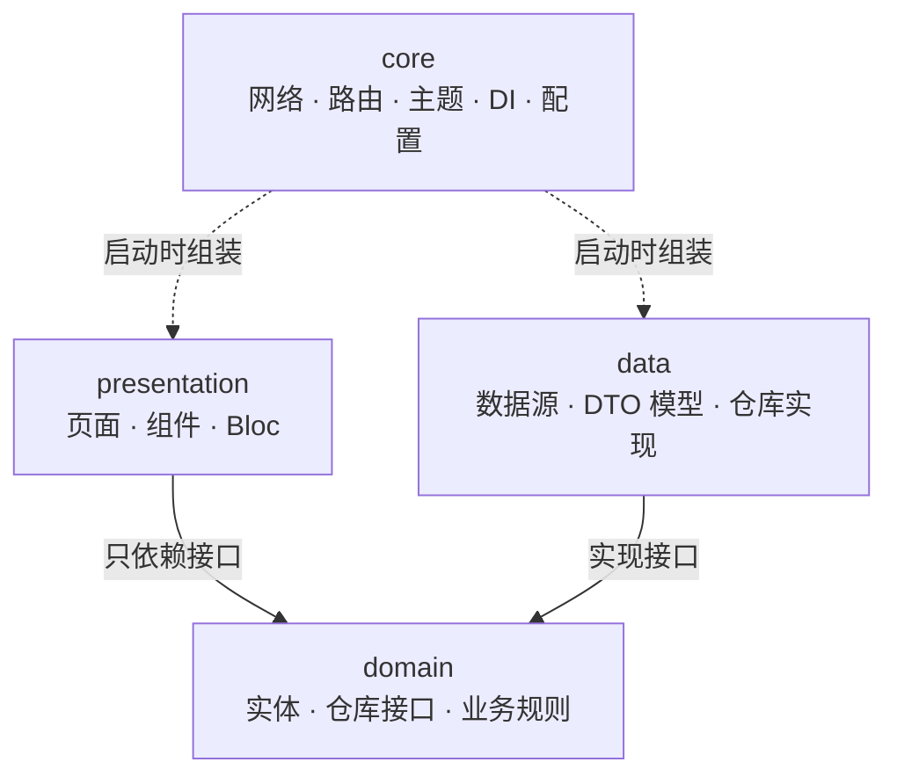
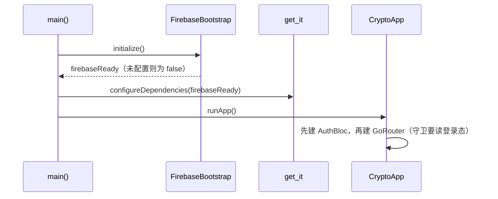
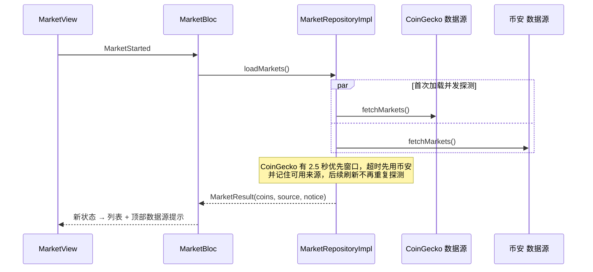
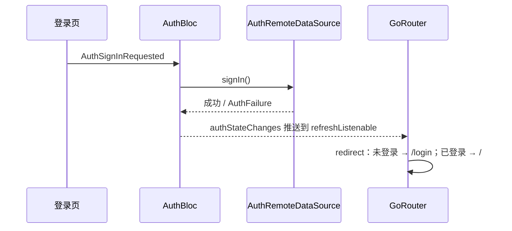

# 架构说明

## 一句话概括

一个 Flutter 加密货币行情 App：**feature-first + data / domain / presentation 三层**组织代码，
状态管理用 `flutter_bloc`，依赖注入用 `get_it`，网络用 `dio`，路由用 `go_router`，
鉴权用 `Firebase Auth`，行情来自 `CoinGecko`（网络受限时自动降级到币安公开行情）。

## 分层与依赖方向



依赖规则一句话：**箭头只朝 domain 指**。
`presentation` 不 import 任何 `data` 层的文件，`data` 实现 `domain` 定义的接口，
具体用哪个实现（CoinGecko / 币安 / Firebase / 本地演示）由 `core/di/injection.dart` 在启动时决定。

## 目录结构

```
lib/
├── main.dart                     入口：初始化 Firebase → 注册依赖 → runApp
├── app.dart                      MaterialApp.router + 全局字号自适应
├── firebase_options.dart         Firebase 配置入口（模板 + dart-define 支持）
├── core/                         跨功能的公共设施，不含业务
│   ├── config/app_config.dart    dart-define 开关（Defines）+ 运行期状态（AppConfig）
│   ├── di/injection.dart         依赖注册：数据源 → 仓库 → Bloc
│   ├── firebase/                 Firebase 初始化与可用性探测
│   ├── network/dio_client.dart   域名、请求头、超时、代理
│   ├── router/app_router.dart    go_router 路由表 + 登录守卫
│   ├── theme/                    配色与主题
│   └── utils/market_formatter.dart  行情数字格式化
└── features/
    ├── auth/                     鉴权（Firebase + 本地演示）
    │   ├── domain/               实体 · 失败类型 · 仓库接口
    │   ├── data/                 两个数据源 + 仓库实现
    │   └── presentation/         Bloc · 页面 · 表单校验
    └── market/                   行情
        ├── domain/               实体 · 数据源枚举 · 仓库接口 · 配置常量
        ├── data/                 两个数据源 + DTO + 仓库实现 + 离线快照
        └── presentation/         Bloc · 页面 · 列表组件
```

## 各层职责

| 层 | 放什么 | 不该放什么 |
| --- | --- | --- |
| `presentation` | 页面、可复用组件、Bloc（事件 / 状态） | 网络请求、JSON 解析、Dio |
| `domain` | 实体、仓库接口、失败类型、业务常量 | Flutter 组件、dio、Firebase |
| `data` | 数据源、DTO 模型、仓库实现 | `BuildContext`、UI 逻辑 |
| `core` | 网络、路由、主题、依赖注入、配置 | 具体业务规则 |

## 三个关键流程

### 1. 启动与依赖组装



### 2. 行情加载：多数据源与自动降级



### 3. 鉴权与路由守卫



## 关键设计决策

1. **鉴权实现可替换**：`domain` 只定义 `AuthRepository` 接口，`data` 提供
   `FirebaseAuthRemoteDataSource` 与 `DemoAuthRemoteDataSource` 两套实现。
   Firebase 未配置或不可达时自动降级，保证界面与流程始终可演示。
2. **行情多数据源**：CoinGecko 是首选与默认；因国内网络不可直连，增加币安公开行情作为
   降级来源。两者字段在 `data` 层统一映射成同一个 `CoinModel`，所以 Bloc 与 UI 完全不感知来源差异，
   只在顶部提示当前实际来源。
3. **币种图标本地化**：图标 CDN 同样不可达，49 个常用币的彩色图标直接内置在 `assets/coins/`
   （来源：开源包 `cryptocurrency-icons`），其余币种回退为字母色块。
4. **配置不落仓库**：Firebase 参数通过 `--dart-define` 注入，本地用 `.dart-defines` 文件
   （已 gitignore），仓库里只保留 `firebase_options.dart` 模板与说明。
5. **弹窗显式注入 Bloc**：`showModalBottomSheet` 打开的是新路由，拿不到页面级 `Provider`，
   所以用 `BlocProvider.value` 显式传进去。
6. **路由守卫用 `refreshListenable`**：把 Bloc 的状态流桥接成 `Listenable`，登录态一变
   就重新执行 `redirect`，避免在页面里手工跳转。

## 新增一个功能页的步骤

1. `domain/entities/` 定义实体
2. `domain/repositories/` 定义仓库接口
3. `data/datasources/` 实现数据源（返回 DTO），`data/repositories/` 实现仓库接口
4. `presentation/bloc/` 写事件 + 状态 + Bloc
5. `presentation/pages/` 写页面，`presentation/widgets/` 拆出可复用组件
6. `core/di/injection.dart` 注册依赖
7. `core/router/app_router.dart` 增加路由

## 与课程学习目标的对应

| 学习目标 | 在本项目中的体现 |
| --- | --- |
| 官方架构指南（UI 层 / 领域层 / 数据层） | `presentation` / `domain` / `data` 三层目录与依赖方向 |
| MVVM | View = 页面与组件；ViewModel = Bloc（持有状态、暴露事件、不含 UI）；Model = 实体 + 仓库 |
| Clean Architecture | 依赖倒置：`presentation → domain ← data`，实现由 `get_it` 在启动时组装 |
| BuildContext 在状态管理与导航中的使用 | `context.read/watch` 驱动 Bloc，弹窗用 `BlocProvider.value` 传递；导航用 `GoRouterState` 与 `context.pushNamed` |
| StatelessWidget / StatefulWidget | 页面级状态用 `StatefulWidget`（登录 / 注册 / 首页 / 搜索框），其余全部 `StatelessWidget`，组件统一拆到 `widgets/` |
| 常用库 | `flutter_bloc` 状态管理、`get_it` 依赖注入、`dio` 网络、`go_router` 路由 |
